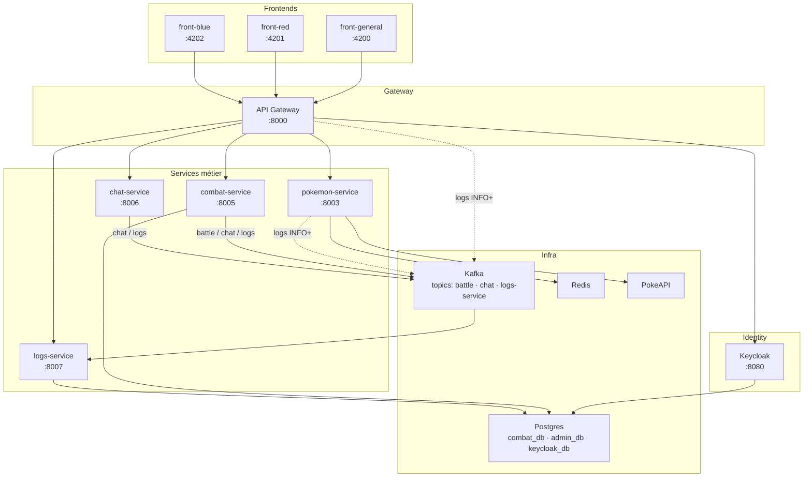

# PokemonDrafter

Projet ICC : application web de duels Pokémon entre équipes Rouge et Bleu, recherche dans le Pokédex, recommandation et gestion d'équipes. Architecture microservices conteneurisée, déployable en Docker Compose ou Kubernetes.

---

## Architecture

### Service map (services réellement implémentés)

| Service | Tech | Port (host → conteneur) | Rôle | README |
|---|---|---|---|---|
| **gateway-service** | Spring Boot 3.4.4 (réactif) | 8000 → 8080 | Point d'entrée unique, JWT Keycloak, routing | [APIGatewayService/README.md](APIGatewayService/README.md) |
| **pokemon-service** | Spring Boot 4.0.2 | 8003 → 8000 | Proxy PokeAPI + cache Redis (FR/EN, types) | [PokemonService/README.md](PokemonService/README.md) |
| **combat-service** | Spring Boot 4.0.2 | 8005 → 8000 | Simulation de duels (modes Draft, Built, Random) | [CombatService/README.md](CombatService/README.md) |
| **chat-service** | FastAPI (Python 3.12) | 8006 → 8000 | Chat WebSocket par duel | [ChatService/README.md](ChatService/README.md) |
| **logs-service** | Spring Boot 4.0.2 | 8007 → 8000 | Collecte centralisée + API admin | [LogsService/README.md](LogsService/README.md) |
| **front-general-service** | Angular 20.3 + Nginx | 4200 → 80 | Landing, login, dashboard, console admin | [FrontGeneralService/README.md](FrontGeneralService/README.md) |
| **front-red-service** | Angular 21.2 + Nginx | 4201 → 80 | Espace joueur Rouge (codebase `FrontColorService`) | [FrontColorService/README.md](FrontColorService/README.md) |
| **front-blue-service** | Angular 21.2 + Nginx | 4202 → 80 | Espace joueur Bleu (même codebase) | [FrontColorService/README.md](FrontColorService/README.md) |
| **kafka** | Apache Kafka KRaft | 9092 | Bus d'événements |
| **postgres** | PostgreSQL 17 | 5432 | Bases : `combat_db`, `admin_db`, `keycloak_db` |
| **redis** | Redis 7 | 6379 | Cache PokeAPI |
| **keycloak** | Keycloak | 8080 | Identity Provider |
| **mailpit** | Mailpit | 8025 (UI), 1025 (SMTP) | Faux SMTP pour intercepter les emails Keycloak en dev |

### Topics Kafka

| Topic | Producteur(s) | Consommateur(s) | Contenu |
|---|---|---|---|
| `battle` | combat-service | (réservé) | Cycle de vie d'un duel : `BATTLE_STARTED`, `TURN_RESOLVED`, `BATTLE_ENDED`, `FORFEIT` |
| `chat` | chat-service, combat-service (bot) | (réservé) | Messages chat |
| `logs-service` | combat-service (events métier) ; tous les services Java via `KafkaLogbackAppender` ; chat-service via `publish_log` | logs-service | Logs centralisés (format unique) |

### Diagramme



---

## Lancement local

### Prérequis

- Docker.
-`kubectl` + minikube pour la voie Kubernetes.

### Docker Compose

```bash
docker compose build
docker compose up -d
```

Tous les services démarrent ; attendre qu'ils soient `healthy` (~1-2 min, Keycloak est le plus long).

URLs :

- Front général : http://localhost:4200
- Front rouge : http://localhost:4201
- Front bleu : http://localhost:4202
- Gateway : http://localhost:8000
- Keycloak admin : http://localhost:8080 (`admin` / `admin`)
- Mailpit (faux SMTP) : http://localhost:8025

### Kubernetes (minikube)

Tutoriel pas-à-pas selon ton shell :

- **Linux / macOS / Git Bash** → [k8s/RUNBOOK-linux.md](k8s/RUNBOOK-linux.md)
- **Windows PowerShell** → [k8s/RUNBOOK-windows.md](k8s/RUNBOOK-windows.md)

En résumé : activer l'addon Ingress, builder les images dans le daemon Docker de minikube, puis déployer en une commande et configurer le DNS local (voir [DNS Kubernetes](#dns-kubernetes)) :

```bash
kubectl apply -f k8s/ -n pokemon-drafter
```

Les runbooks couvrent aussi la surveillance des pods, le dépannage Kafka, le reset des PVC et le tear down.

---

## Utilisateurs préexistants

Définis dans `keycloak/realm-export.json` (importés au premier démarrage).

| Username | Password | Rôle |
|---|---|---|
| `red_player1` | `password1` | Joueur Rouge |
| `red_player2` | `password2` | Joueur Rouge |
| `blue_player1` | `password1` | Joueur Bleu |
| `blue_player2` | `password2` | Joueur Bleu |
| `admin` | `admin` | Administrateur |

> Si tu modifies `realm-export.json`, Keycloak ne ré-importe **qu'au premier démarrage avec base vide**. Pour réimporter : `docker compose down -v && docker compose up --build`.
>
> Ce fichier est la seule source du realm. Kubernetes le reçoit via `k8s/keycloak-realm.yml`, généré par `./k8s/sync-realm.sh` : relancer le script après chaque modification et commiter les deux fichiers.

---

## Authentification par fonctionnalité

| Fonctionnalité | Route gateway | Auth |
|---|---|---|
| Recherche Pokédex | `GET /api/pokemon/**`, `GET /api/types/**` | publique |
| Login / signup / reset | `POST /api/auth/**` | publique |
| Combat | `/api/combat/**` | JWT requis |
| Chat WebSocket | `/api/chat/{combatId}` (chat-service en direct) | JWT requis + participant du combat |
| Console logs admin | `/api/logs/**` | JWT + rôle `admin` |

L'extraction du rôle Keycloak (claim `realm_access.roles`) est faite par `SecurityConfig` côté gateway et redoublée côté `logs-service` (défense en profondeur).

Le chat ne passe pas par la gateway : un navigateur ne peut pas envoyer d'en-tête `Authorization` sur un WebSocket. Le front envoie donc le jeton dans la première trame (`{"type": "auth", "token": "..."}`), jamais dans l'URL. `chat-service` vérifie la signature du jeton avec les clés publiques de Keycloak, en tire le pseudo, puis demande à `combat-service` si ce joueur est Rouge ou Bleu dans ce combat. Le client ne choisit ni son pseudo ni sa couleur ; un non-participant est refusé (code 1008).

---

## Console admin — logs centralisés

Voir [LogsService/README.md](LogsService/README.md) pour le détail du flux.

**Comment ça marche** :

1. Les services Java (`gateway`, `pokemon`, `combat`) embarquent un appender Logback `KafkaLogbackAppender` qui publie tout log >= INFO sur le topic Kafka `logs-service`.
2. `chat-service` (Python) fait pareil via `KafkaProducerClient.publish_log`.
3. `combat-service` publie en plus des évènements métier structurés (`BATTLE_STARTED`, `BATTLE_ENDED`).
4. `logs-service` consomme le topic (`@EnableKafka` + `@KafkaListener`), persiste dans `admin_db.log_entries`, et expose `GET /logs` pour la console.
5. La gateway autorise `/api/logs/**` au seul rôle `admin`.
6. Le frontend `front-general-service` affiche `/admin/logs` après login en tant que `admin` (filtres par service / par niveau / recherche texte, polling 5 s).

**Tolérance au boot** : le broker Kafka est configuré avec `KAFKA_AUTO_CREATE_TOPICS_ENABLE=true`, et chaque `KafkaLogbackAppender` retente la publication pendant 60 s. Aucun log n'est perdu si Kafka démarre après un producer. Voir [LogsService/README.md](LogsService/README.md) section "Tolérance au démarrage".

**Tester** :

- Login `admin / admin` sur http://localhost:4200 → un bouton "Console admin — logs" apparaît.
- En tant que joueur, l'URL `/admin/logs` redirige vers le dashboard et l'API renvoie 403.

---

## Emails transactionnels (dev — Mailpit)

Keycloak envoie des emails (vérification, reset password, actions). En dev local, le SMTP de Keycloak pointe sur le service `mailpit` :

- Inbox : http://localhost:8025
- Aucun email ne sort vers Internet.
- Adresses fictives type `red_player1@pokemon-drafter.local` OK.

En prod : remplacer le bloc `smtpServer` du realm par un vrai SMTP et supprimer le service `mailpit`.

---

## Cahier des charges vs implémentation

Pour faciliter l'évaluation, les écarts entre le PDF et la livraison actuelle :

**Livré** : authentification Keycloak (joueurs + admin), Pokédex (recherche FR/EN, fiche détail, types, matrice d'efficacité), duels Spring Boot (modes Draft/Built/Random, formule d'avantage, persistence), chat WebSocket par duel, **console admin de logs centralisés**, déploiement Docker Compose et Kubernetes.

**Non livré dans cette itération** :

- `back-red-service` / `back-blue-service` séparés (CRUD équipes, scores, équipes par joueur). La logique combat est aujourd'hui mutualisée dans `combat-service`.
- `recommendation-service` (bouton "Compléter une équipe").
- Chiffrement par clé privée des échanges inter-backends (sans pertinence tant que les backends Rouge/Bleu sont mutualisés).
- Page Mes Équipes / Historique des parties / sous-menu utilisateur (changement pseudo / avatar / couleur).
- Mode Pioche complet côté UI.

---

## Assets tiers & licences

| Asset | Source | Licence | Emplacement |
|---|---|---|---|
| Pokémon type icons (18 SVG) | [James Watkins, 2022](https://github.com/jamesw2/pokemon-type-icons) | MIT | [images/icons/](images/icons/) et [FrontColorService/public/assets/types/](FrontColorService/public/assets/types/) |

Le texte de la licence MIT est conservé à côté des icônes (`images/icons/LICENSE`, `FrontColorService/public/assets/types/LICENSE`).

---

## DNS Kubernetes

L'Ingress nginx de minikube (`minikube addons enable ingress`) route chaque sous-domaine vers son service :

| URL | Service |
|---|---|
| http://pokemon-drafter.local | Front général (point d'entrée) |
| http://red.pokemon-drafter.local | Front Rouge |
| http://blue.pokemon-drafter.local | Front Bleu |
| http://api.pokemon-drafter.local | Gateway ; `/api/chat` va directement à chat-service (WebSocket) |
| http://auth.pokemon-drafter.local | Keycloak (`admin` / `admin`) |
| http://mail.pokemon-drafter.local | Mailpit (emails Keycloak) |

Ajouter ces noms au fichier hosts, après `kubectl apply -f k8s/ -n pokemon-drafter` :

- **Linux** : l'IP de minikube est joignable directement.

  ```bash
  echo "$(minikube ip) pokemon-drafter.local red.pokemon-drafter.local blue.pokemon-drafter.local api.pokemon-drafter.local auth.pokemon-drafter.local mail.pokemon-drafter.local" | sudo tee -a /etc/hosts
  ```

- **macOS / Windows** (driver Docker) : lancer `minikube tunnel` dans un terminal laissé ouvert (administrateur sous Windows), et pointer les mêmes noms sur `127.0.0.1` (`/etc/hosts`, ou `C:\Windows\System32\drivers\etc\hosts`).

Accès : http://pokemon-drafter.local. Détail pas-à-pas dans les runbooks.
