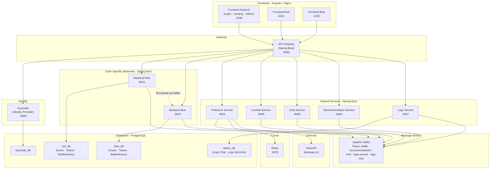

# PokemonDrafter

## Architecture

### Service Map

| Service | Tech | Port (Docker) | Description |
|---|---|---|---|
| **gateway-service** | Spring Boot | 8000 → 8080 | API Gateway – single entry point |
| **back-red-service** | Java Spring Boot | 8001 → 8000 | Backend for Red team users |
| **back-blue-service** | Java Spring Boot | 8002 → 8000 | Backend for Blue team users |
| **pokemon-service** | Java Spring Boot | 8003 → 8000 | PokeAPI calls + Redis cache |
| **recommendation-service** | Java Spring Boot | 8004 → 8000 | Team completion engine |
| **combat-service** | Java Spring Boot | 8005 → 8000 | Duel simulation |
| **chat-service** | Java Spring Boot | 8006 → 8000 | In-game chat |
| **logs-service** | Java Spring Boot | 8007 → 8000 | Service & chat logs (admin) |
| **front-general-service** | Angular + Nginx | 4200 → 80 | Landing, login, admin console |
| **front-red-service** | Angular + Nginx | 4201 → 80 | Red team portal |
| **front-blue-service** | Angular + Nginx | 4202 → 80 | Blue team portal |
| **kafka** | Apache Kafka | 9092 | Message broker |
| **postgres** | PostgreSQL 17 | 5432 | Databases: red_db, blue_db, admin_db, keycloak_db |
| **redis** | Redis 7 | 6379 | PokeAPI data cache |
| **keycloak** | Keycloak | 8080 | Identity Provider (auth + tokens) |

### Architecture Diagram



### Data Flow

1. **User Authentication** — Frontend → Gateway → Keycloak → JWT token returned
2. **Team Management** — Frontend Red/Blue → Gateway → Backend Red/Blue → red_db / blue_db
3. **Pokédex Search** — Frontend → Gateway → Pokemon Service → Redis cache (or PokeAPI fallback)
4. **Team Recommendation** — Frontend → Gateway → Recommendation Service (reads team via Kafka from Backend)
5. **Duel** — Both backends publish moves to Kafka → Combat Service resolves → results published back via Kafka
6. **Chat** — Frontend → Gateway → Chat Service → Kafka (logs topic) → Logs Service → admin_db
7. **Inter-backend communication** — Red ↔ Blue backends do NOT communicate directly; all data passes through Kafka and is **encrypted with a shared private key**

---

## Per-service Documentation

Each microservice maintains its own README detailing its API, endpoints, configuration and internal architecture.

| Service | Documentation |
|---|---|
| pokemon-service | [PokemonService/README.md](PokemonService/README.md) |

> Add a row here whenever a new service ships its README.

---

## Deployment

### Docker Compose (local dev)

```bash
docker compose up --build
```

### Kubernetes

```bash
kubectl apply -f k8s/pokemon-drafter.yml
kubectl apply -f k8s/manifest.yml -n pokemon-drafter
```

---

## Pre-existing Users

| Username | Password | Team |
|---|---|---|
| `red_player1` | `password1` | Red |
| `red_player2` | `password2` | Red |
| `blue_player1` | `password1` | Blue |
| `blue_player2` | `password2` | Blue |
| `admin` | `admin` | Admin |

> **Note:** Update this table once Keycloak is seeded with actual user data.

---

## DNS (Kubernetes)

Configure a local DNS entry pointing to the gateway-service LoadBalancer IP:

```
<gateway-external-ip>  pokemon-drafter.local
```

Access the application at `http://pokemon-drafter.local`.
