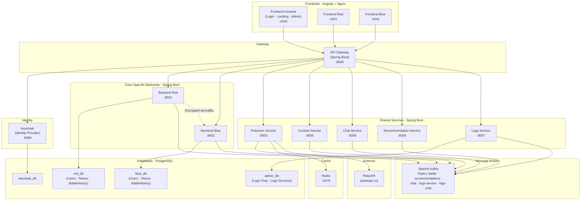

# PokemonDrafter

## Architecture

### Service Map

| Service | Tech | Port (Docker) | Description |
|---|---|---|---|
| **gateway-service** | Spring Boot | 8000 → 8080 | API Gateway – single entry point |
| **back-red-service** | Java Spring Boot | 8001 → 8000 | Backend for Red team users |
| **back-blue-service** | Java Spring Boot | 8002 → 8000 | Backend for Blue team users |
| **pokemon-service** | Java Spring Boot | 8003 → 8000 | PokeAPI calls + Redis cache |
| **recommendation-service** | Java Spring Boot | 8004 → 8000 | Team completion engine |
| **combat-service** | Java Spring Boot | 8005 → 8000 | Duel simulation |
| **chat-service** | Java Spring Boot | 8006 → 8000 | In-game chat |
| **logs-service** | Java Spring Boot | 8007 → 8000 | Service & chat logs (admin) |
| **front-general-service** | Angular + Nginx | 4200 → 80 | Landing, login, admin console |
| **front-red-service** | Angular + Nginx | 4201 → 80 | Red team portal |
| **front-blue-service** | Angular + Nginx | 4202 → 80 | Blue team portal |
| **kafka** | Apache Kafka | 9092 | Message broker |
| **postgres** | PostgreSQL 17 | 5432 | Databases: red_db, blue_db, admin_db, keycloak_db |
| **redis** | Redis 7 | 6379 | PokeAPI data cache |
| **keycloak** | Keycloak | 8080 | Identity Provider (auth + tokens) |

### Architecture Diagram



### Data Flow

1. **User Authentication** — Frontend → Gateway → Keycloak → JWT token returned
2. **Team Management** — Frontend Red/Blue → Gateway → Backend Red/Blue → red_db / blue_db
3. **Pokédex Search** — Frontend → Gateway → Pokemon Service → Redis cache (or PokeAPI fallback)
4. **Team Recommendation** — Frontend → Gateway → Recommendation Service (reads team via Kafka from Backend)
5. **Duel** — Both backends publish moves to Kafka → Combat Service resolves → results published back via Kafka
6. **Chat** — Frontend → Gateway → Chat Service → Kafka (logs topic) → Logs Service → admin_db
7. **Inter-backend communication** — Red ↔ Blue backends do NOT communicate directly; all data passes through Kafka and is **encrypted with a shared private key**

---

## Per-service Documentation

Each microservice maintains its own README detailing its API, endpoints, configuration and internal architecture.

| Service | Documentation |
|---|---|
| pokemon-service | [PokemonService/README.md](PokemonService/README.md) |

> Add a row here whenever a new service ships its README.

---

## Frontend — Theme system (`FrontColorService`)

The Angular frontend is **one codebase** deployed as two containers (`front-red-service`, `front-blue-service`), parameterized at runtime by `COLOR=red|blue`.

### Themes

| Theme     | Trigger                                       | Visual                                             |
|-----------|-----------------------------------------------|----------------------------------------------------|
| `neutral` | Not authenticated (regardless of `COLOR` env) | Thin red line header + Honor Ball button (ring)    |
| `red`     | Authenticated, `COLOR=red`                    | Red stripe header + black separator + Poké Ball    |
| `blue`    | Authenticated, `COLOR=blue`                   | Blue stripe header + black separator + Super Ball  |
| `love`    | Easter egg: 5 clicks on the pokeball in < 2 s | Pink stripe + Love Ball (toggle, re-spam to leave) |

### `ThemeService` — public API

Reactive service at `FrontColorService/src/app/core/theme/theme.service.ts`.

```ts
readonly theme: Signal<Theme>                         // current theme
readonly pokeballVariant: Signal<PokeballVariant>     // pokeball asset name
readonly isAuthenticated: Signal<boolean>             // readonly auth flag

setAuthenticated(value: boolean): void                // triggers theme transition
registerPokeballClick(): void                         // Love-Ball easter egg counter
```

### Animated theme transitions

Every state change that affects the theme (login, logout, easter-egg toggle) is wrapped in a **circle-reveal animation** that originates from the pokeball button at the top-right. Implemented with the View Transitions API (`document.startViewTransition`) + a custom `@keyframes pokeball-reveal` in `src/styles.css`. Firefox falls back to the browser's default cross-fade — no ugly flicker.

### Hooking up login / logout

The Keycloak integration (in progress) must call these methods on auth state changes — do **not** mutate env vars or `data-theme` directly, otherwise the circle-reveal will not play:

```ts
// After Keycloak login success
themeService.setAuthenticated(true);   // neutral → red/blue with circle reveal

// After logout
themeService.setAuthenticated(false);  // red/blue → neutral with circle reveal
```

The same method serves signup success flows.

### Adding a new theme

1. Add the theme name to `Theme` type in `src/app/core/theme/theme.types.ts`.
2. Add `[data-theme="<name>"]` block in `src/styles.css` overriding `--theme-color` and `--separator-color`.
3. Add a pokeball PNG at `public/assets/ui/<name>ball.png` (optional — only if the header pokeball variant differs) and update `POKEBALL_ASSETS` in the pokeball-button component if the asset is used.
4. Update the `theme` computed in `ThemeService` to produce the new theme under the relevant condition.

---

## Deployment

### Docker Compose (local dev)

```bash
docker compose up --build
```

### Kubernetes

```bash
kubectl apply -f k8s/pokemon-drafter.yml
kubectl apply -f k8s/manifest.yml -n pokemon-drafter
```

---

## Pre-existing Users

| Username | Password | Team |
|---|---|---|
| `red_player1` | `password1` | Red |
| `red_player2` | `password2` | Red |
| `blue_player1` | `password1` | Blue |
| `blue_player2` | `password2` | Blue |
| `admin` | `admin` | Admin |

> **Note:** Update this table once Keycloak is seeded with actual user data.

---

## Emails transactionnels (dev : Mailpit)

Keycloak envoie des emails dans plusieurs flows : réinitialisation de mot de passe, vérification d'email, actions utilisateur (`execute-actions-email`). En **dev local**, ces emails sont **interceptés par Mailpit** — un faux serveur SMTP qui capture tout dans une UI web consultable.

- **Serveur SMTP configuré** dans `keycloak/realm-export.json` → `smtpServer.host = mailpit:1025` (réseau Docker interne)
- **Inbox** : `http://localhost:8025` (port Mailpit UI)
- **Aucun email ne sort vers Internet** tant que la config pointe sur `mailpit`
- Tu peux donc utiliser des adresses fictives comme `red_player1@pokemon-drafter.local` sans risque

**En prod** : remplacer le bloc `smtpServer` du realm par les credentials d'un vrai SMTP (Gmail SMTP, SendGrid, SES, etc.) et supprimer le service `mailpit` du `docker-compose.yml`.

> ⚠️ Si tu modifies `realm-export.json` (smtpServer, users, clients…), Keycloak ne ré-importe **qu'au premier démarrage** d'une BDD vide. Pour appliquer les changements : `docker compose down -v && docker compose up --build`.

---

## Authentification par fonctionnalité

Toutes les routes derrière la gateway ne sont pas identiques côté auth. Résumé :

| Fonctionnalité | Route gateway | Auth Keycloak requise |
|---|---|---|
| Recherche Pokédex | `GET /api/pokemon/search` | Non (consultation publique) |
| Fiche détail d'un Pokémon | `GET /api/pokemon/{id}` | Non (consultation publique) |
| Matrice d'efficacité des types | `GET /api/types/effectiveness` | Non |
| Ajout d'un Pokémon à une équipe | `POST /api/{color}/teams/{id}/pokemon` | **Oui** (rôle `red_player` ou `blue_player`) |
| CRUD équipes | `/api/{color}/teams/**` | **Oui** |
| Duel, chat, logs, recommendation | `/api/combat/**`, `/api/chat/**`, `/api/logs/**`, `/api/recommendation/**` | **Oui** |

La configuration de la gateway (`APIGatewayService/src/main/resources/application.yml`) et/ou `SecurityConfig.java` doit donc distinguer les routes publiques (`/api/pokemon/**`, `/api/types/**`) des routes authentifiées.

### Tests

- **Consultation (Pokédex)** : tests unitaires front classiques avec `HttpClient` mocké (`provideHttpClientTesting`).
- **Ajout à une équipe** : tests unitaires front + tests back-color avec **base de données mockée** (Testcontainers PostgreSQL ou H2 en profil test). Ne jamais taper une vraie DB de dev.

---

## Third-party assets & licenses

| Asset | Source | License | Location |
|---|---|---|---|
| Pokémon type icons (18 SVG) | [James Watkins, 2022](https://github.com/jamesw2/pokemon-type-icons) | MIT | [images/icons/](images/icons/) and [FrontColorService/public/assets/types/](FrontColorService/public/assets/types/) |

The MIT license text is preserved next to the icons (`images/icons/LICENSE`, `FrontColorService/public/assets/types/LICENSE`).

---

## DNS (Kubernetes)

Configure a local DNS entry pointing to the gateway-service LoadBalancer IP:

```
<gateway-external-ip>  pokemon-drafter.local
```

Access the application at `http://pokemon-drafter.local`.
