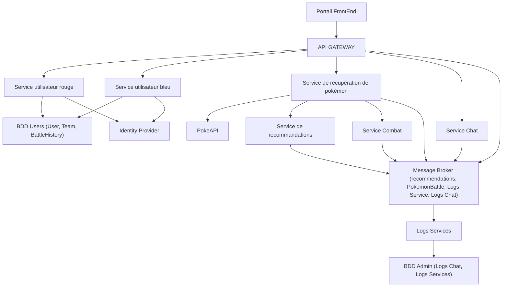
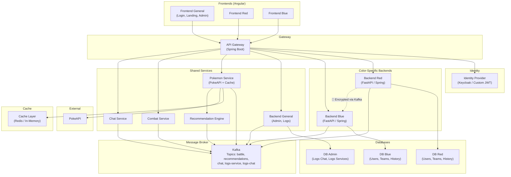

# Architecture Schema Analysis — PokemonDrafter

## 1. What the PDF Requires (Key Constraints)

From the project specification:

| Requirement | Detail |
|---|---|
| **Separate front+back per color** | A distinct frontend AND backend for Red and Blue teams. They don't communicate directly. |
| **Encrypted inter-backend data** | Data sent between backends must be encrypted with a private key. |
| **API Gateway / Reverse Proxy** | Required (technology choice is open). |
| **Identity Provider** | Required (technology choice is open). |
| **Message Broker** | Kafka is required. |
| **Frontend** | Angular required. |
| **Backend** | REST — Python FastAPI recommended, Java Spring Boot or Go Gin accepted. |
| **Database** | Relational (choice is open). Must persist across restarts. |
| **PokeAPI** | External API for Pokémon data (with caching recommended). |
| **Recommendation Engine** | Suggest Pokémon to complete a team. |
| **Combat/Duel System** | Simulate battles between Red and Blue players. |
| **Chat** | In-game chat with color-restricted messaging option. |
| **Admin Console** | Logs for all services, accessible by admin only. |
| **Battle History** | Store + display match history per user. |
| **Docker + Kubernetes** | All services containerized. Deployed via `kubectl apply -f`. |

---

## 2. Your Diagram — What It Shows

From the image, the architecture has these components:

---

## 3. Analysis: Is This Schema the Best to Use?

### ✅ What the diagram gets RIGHT

1. **API Gateway as entry point** — Correct. All client traffic goes through one gateway.
2. **Separate Red and Blue services** ("Service utilisateur bleu/rouge") — Matches the requirement for distinct backends per color.
3. **Pokémon retrieval service** calling PokeAPI — Correct, centralizes API calls and enables caching.
4. **Message Broker with topics** (recommendations, PokemonBattle, Logs) — Good use of Kafka for async communication.
5. **Separate Logs Service + BDD Admin** — Matches the admin console requirement.
6. **Identity Provider** — Present and connected to the user services.
7. **Recommendation & Combat as separate services** — Good microservice separation.
8. **Chat service** — Present as required.

### ⚠️ Issues and Concerns

#### 1. Single Frontend — Missing Separate Frontends per Color

> [!WARNING]
> The PDF explicitly requires: *"Vous devrez avoir un front et un back différent pour chaque couleur d'équipe."*
> Your diagram shows a single "Portail FrontEnd". You need **3 frontends**: one for Red, one for Blue, and one general/landing (which your docker-compose already has: `front-red-service`, `front-blue-service`, `front-general-service`).

#### 2. Shared BDD Users for Both Colors

> [!IMPORTANT]
> The diagram shows a single "BDD Users" database shared by both Red and Blue services. This contradicts the spirit of the separation requirement. Your `docker-compose.yml` already correctly has **separate databases** (`blue_db`, `red_db`, `adminLogs_db`). The diagram should reflect this.

#### 3. Missing Data Encryption Between Backends

> [!CAUTION]
> The PDF requires: *"la data envoyée d'un backend à un autre doit être chiffrée par une clé privée."*
> The diagram doesn't show any encryption layer or engine between the Red and Blue backends. You need to represent the encryption mechanism (likely through the Message Broker or a dedicated encryption service).

#### 4. Combat Service Placement is Unclear

The Combat Service is floating to the side with no clear connection to the user services. In practice:
- A Red user and a Blue user both need to participate in a duel.
- The Combat service must receive moves from **both** backends (via Kafka) and broadcast results back.
- The diagram should show this flow more clearly.

#### 5. Chat Service Connections

The Chat service connects to the API Gateway and the Message Broker, which is fine. But it should also be clear that:
- Chat messages from duels need to go through Kafka topics.
- The bot messages (turn summary, winner, etc.) come from the Combat service.

#### 6. No Pokémon Data Cache Represented

The PDF tip says: *"votre programme sera plus performant si vous cachez la data."* There's no cache layer (Redis, in-memory, etc.) shown between the Pokémon retrieval service and PokeAPI. This should be represented.

#### 7. Recommendation Service Should Be More Connected

The recommendation engine needs access to type effectiveness data and the user's current team. The diagram shows it connected to the Message Broker and the Pokémon service, but it should clarify how it gets team data (from the user's backend/DB).

---

## 4. Your Current Codebase vs. The Diagram

| Component | Diagram | Codebase (docker-compose / k8s) | Match? |
|---|---|---|---|
| API Gateway | ✅ | ✅ `gateway-service` (Spring Boot) | ✅ |
| Backend Red | ✅ "Service utilisateur rouge" | ✅ `back-red-service` | ✅ |
| Backend Blue | ✅ "Service utilisateur bleu" | ✅ `back-blue-service` | ✅ |
| Backend General | ❌ Not in diagram | ✅ `back-general-service` | ⚠️ Diagram missing |
| Frontend Red | ❌ Single frontend | ✅ `front-red-service` | ⚠️ Diagram missing |
| Frontend Blue | ❌ Single frontend | ✅ `front-blue-service` | ⚠️ Diagram missing |
| Frontend General | ❌ Single frontend | ✅ `front-general-service` | ⚠️ Diagram missing |
| Kafka | ✅ "Message Broker" | ✅ `kafka` | ✅ |
| PostgreSQL | ✅ "BDD Users" + "BDD Admin" | ✅ `postgres` (with 3 DBs) | ✅ |
| PokeAPI | ✅ | Not a local service (external) | ✅ |
| Identity Provider | ✅ | ❌ Not yet implemented | ⚠️ |
| Recommendation Service | ✅ | ❌ Not yet implemented | ⚠️ |
| Combat Service | ✅ | ❌ Not yet implemented | ⚠️ |
| Chat Service | ✅ | ❌ Not yet implemented | ⚠️ |
| Logs Service | ✅ | ❌ Not yet implemented | ⚠️ |
| Cache Layer | ❌ | ❌ | ❌ Both missing |

---

## 5. Recommended Improved Architecture

Here's what I'd recommend based on the requirements:

### Key Improvements Over Your Diagram:
1. **3 separate frontends** (Red, Blue, General) as required.
2. **Separate databases** per color + admin.
3. **Cache layer** for PokeAPI data.
4. **Encryption** represented between Red/Blue backends via Kafka.
5. **Backend General** for admin/logs functionality.
6. **Clearer data flow** — shows which services talk to which databases.

---

## 6. Verdict

> [!IMPORTANT]  
> **Your schema is a solid starting point but is NOT complete enough to use as-is.** It captures the core microservice decomposition well, but it's missing critical requirements (separate frontends, separate DBs per color, encryption, cache). Your `docker-compose.yml` is actually **more accurate** than the diagram — update the diagram to match it and add the missing services.

### Priority fixes for the diagram:
1. Split the single frontend into 3 (Red, Blue, General)
2. Split "BDD Users" into separate Red/Blue databases
3. Add the encryption layer notation between backends
4. Add a cache layer for PokeAPI
5. Add the "Backend General" service for admin/logs
